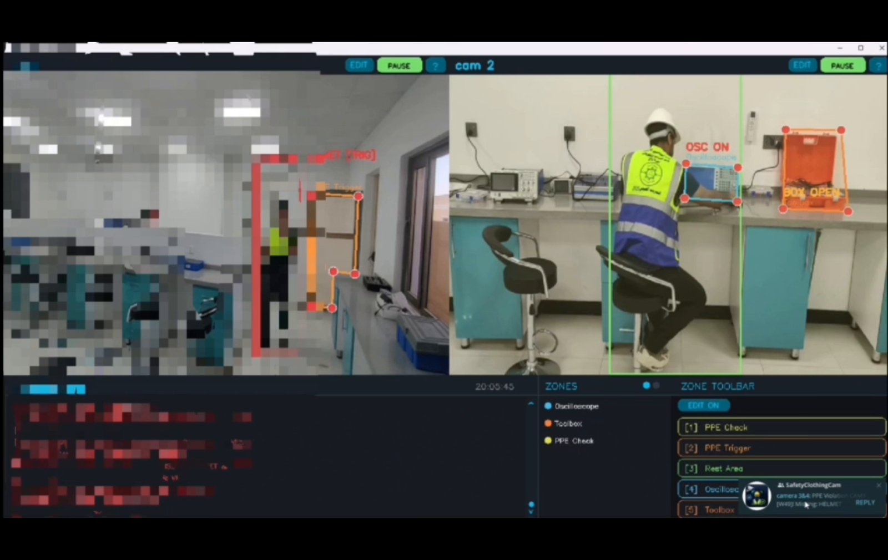
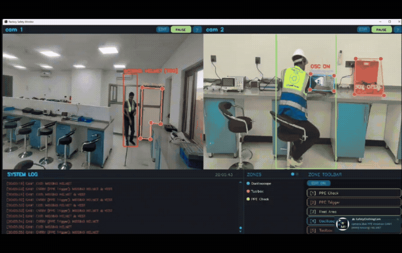
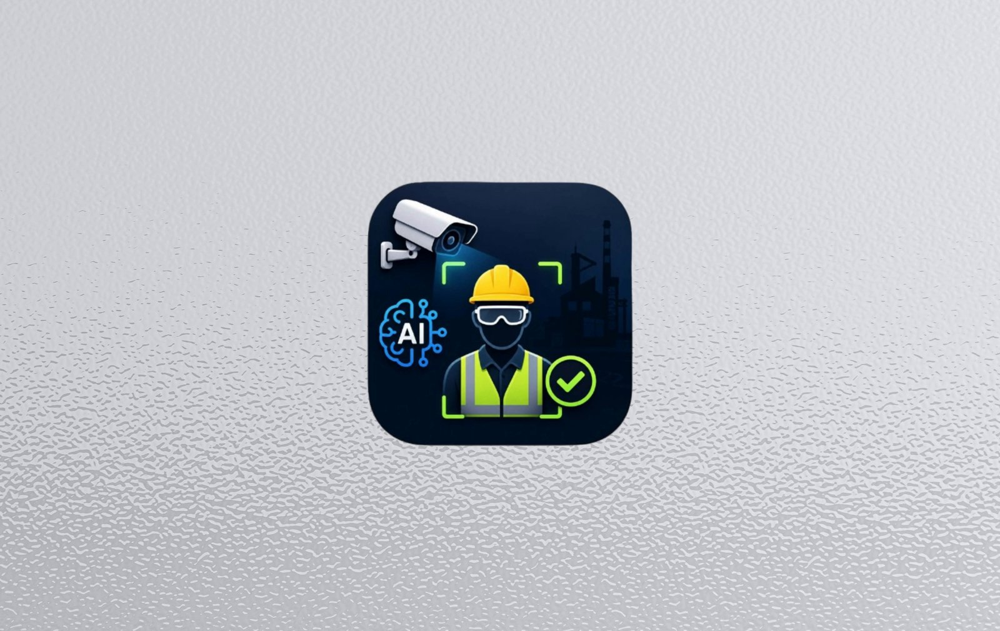

# SAFETY CAM — AI-Based PPE Compliance & Asset Tracking

**Real-time workplace safety monitoring with computer vision.** Safety Cam watches ordinary CCTV / IP cameras, detects workers, checks whether they are wearing the protective equipment required in each zone, and sends an instant Telegram alert with a photo when someone is not.

> 🎓 Graduation project — B.Sc. Computer Technology Engineering, Al-Bayan University (Baghdad, Iraq), 2026–2027
> 🏆 National Finalist — **NURAI 2026**, Iraq's national university championship for robotics & AI (selected for the ministry judges' final interview, score 84.5/100)



▶️ **[Watch the full demo video](media/safety_cam_demo.mp4)**



---

## The problem

The ILO estimates hundreds of millions of occupational accidents every year, and Iraq's Ministry of Labour recorded thousands of private-sector workplace injuries in 2024 alone. Most sites already have cameras, but they are watched by people who get tired, so violations are only found afterwards — if at all. Safety Cam turns those existing cameras into an active safety system.

## What it does

| Feature | Details |
|---|---|
| **Person detection & tracking** | YOLOv8n finds people in every frame; each person keeps an ID between frames. |
| **Per-zone PPE checks** | Draw zones on each camera and choose what each zone checks: helmet, vest, goggles, gloves, shoes, harness, lab coat — or **smoking** (behaviour). |
| **Three zone types** | *Inspection* (checked continuously), *Trigger* (checked when a person enters), *Rest area* (no checks). Zones can be paused for N hours. |
| **Grace period** | A violation must persist (default 10 s) before it is reported, which removes false alarms from momentary occlusion. |
| **Instant alerts** | Telegram message + snapshot to a group, plus an on-screen admin log and a daily alerts folder. |
| **Multi-camera** | Webcams, video files, IP cameras and NVR streams (RTSP) with automatic reconnection, each on its own thread. |
| **Asset tracking** | Watches tool zones (e.g. oscilloscope / toolbox) and flags missing or unreturned equipment. |
| **After-hours room watch** | Detects lights left on or people present outside shift hours. |
| **DVR recording** | Continuous annotated recording with playback and automatic clean-up by age / disk size. |
| **Remote dashboard** | Optional password-protected web dashboard reachable from anywhere through a Cloudflare Tunnel. |
| **Runs on ordinary PCs** | Models are exported to ONNX and run with ONNX Runtime (DirectML GPU or CPU) — no PyTorch or NVIDIA GPU needed at runtime. |



## How it works

```
Camera / RTSP / video ──► Frame grabber (thread per camera)
                              │
                              ▼
                     PersonDetector (YOLOv8n, ONNX)
                              │  person boxes + track IDs
                              ▼
            Zone logic (point-in-polygon, entry triggers, grace period)
                              │  crop of each person in a zone
                              ▼
             PPE worker (custom YOLOv8 detectors, ONNX) ──► "vote" per item
                              │
              ┌───────────────┼──────────────────┐
              ▼               ▼                  ▼
      On-screen overlay   Telegram alert      DVR recording
        + admin log        (text + photo)     + web dashboard
```

## Models

Custom YOLOv8 detectors were trained on Roboflow datasets (and merged datasets for gloves/goggles) on a local GTX 1660 Ti, then exported to ONNX:

| Model | Detects |
|---|---|
| `yolov8n` | People |
| `best_ppe` / `best_ppe_v2` | Hardhat, no-hardhat, safety vest, no-vest |
| `best_ppe_plus` | Extended PPE classes |
| `best_helmet`, `best_gloves`, `best_goggles`, `best_labcoat` | Single-item specialists |
| `best_smoking` | Smoking behaviour |
| `best_workshop` | Lab assets (oscilloscope, toolbox) |

> Model weights are not stored in this repository because of their size. They are available on request.

## Repository layout

```
src/factory_safety_monitor.py   The full application (GUI, detection, zones, alerts, DVR, web dashboard)
training/train_models.py        Trains each detector with Ultralytics YOLOv8
training/merge_datasets.py      Merges several Roboflow datasets into one (gloves, goggles)
training/export_onnx.py         Exports trained .pt weights to ONNX for the app
experiments/                    Earlier prototypes: single-camera entry check, PPE camera, multi-camera pipeline
build/                          PyInstaller spec + build script for the Windows .exe
config/system_config.example.json  Example configuration (no credentials)
media/                          Screenshots and demo video
```

## Running it

```bash
pip install -r requirements.txt
# put yolov8n.onnx and the best_*.onnx detector files next to factory_safety_monitor.py
python src/factory_safety_monitor.py
```

The setup window lets you add cameras, enter your own Telegram bot token and chat ID, and set up remote access. Credentials are saved locally in `system_config.json`, which is excluded from this repository.

To build the Windows executable: see [`build/ONEDIR_BUILD_GUIDE.md`](build/ONEDIR_BUILD_GUIDE.md).

## Tech stack

Python · OpenCV · Ultralytics YOLOv8 · ONNX Runtime (DirectML) · Roboflow · Tkinter · Flask · Cloudflare Tunnel · Telegram Bot API · PyInstaller

## Status & next steps

This is the graduation-project version, developed further since the NURAI 2026 competition. Work in progress:

- Evaluation on a separate, unseen test set (precision / recall / mAP), FPS and alert-latency measurements, and an ablation of the grace period and multi-model voting.
- An IoT layer: an ESP32 on-site siren / warning light triggered over MQTT when a violation is confirmed.

## Author

**Yousif Ezzat Salih** — Computer Technology Engineering, Al-Bayan University, Baghdad
[LinkedIn](https://www.linkedin.com/in/yousif-al-jumaili) · Team **AI Cartel** (NURAI 2026)
